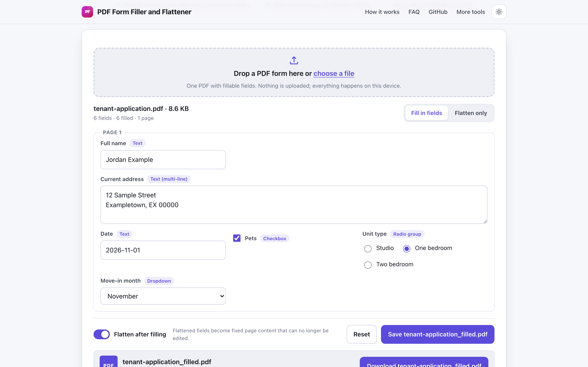
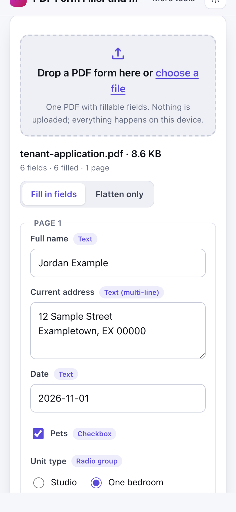

# PDF Form Filler and Flattener

> Fill in PDF form fields and flatten them into plain pages in your browser, with no upload.

**🌐 Use it now: [turhe123.github.io/pdf-form-flattener](https://turhe123.github.io/pdf-form-flattener/)** · free · open source · runs in your browser · works offline


## Why

Tax, visa, rental and HR forms often have to be filled in and sent as a PDF that the recipient cannot alter. This is a free, open-source alternative to Smallpdf and Sejda Flatten PDF, which upload forms containing personal data, apply free task limits, and ask for an account or a paid plan for more. Here your files never leave the device, there is no account, no ads and no limits, it works offline, and it can be installed as an app.

## Screenshots

<p align="center"></p>

<p align="center"><em>PDF Form Filler and Flattener in the browser, light theme</em></p>

<p align="center"></p>

<p align="center"><em>PDF Form Filler and Flattener on a phone</em></p>

## Features

- Opens one PDF by drag and drop or file picker and lists every interactive (AcroForm) field, grouped by page, with the field name as the label and its type shown.
- Proper control per field type: single-line input, textarea for multi-line text, checkbox, radio group, dropdown and option list (including multi-select).
- Summary of how many fields there are, how many are filled, the page count and how many were skipped.
- "Flatten after filling" switch (on by default) turns the values into fixed page content and removes the fields.
- "Flatten only" mode skips editing and flattens the form as it is.
- Saves as `yourfile_filled.pdf`, with a result card showing the size and how many form fields are left.
- Values are drawn with the built-in Helvetica font. Characters it cannot draw are flagged per field, with a "Replace them" button for the closest plain letters.
- Respects field limits: maximum length is enforced, long single-line text switches to auto font size where the field allows it, and read-only fields are shown disabled.
- Signature and button fields are skipped. Anything that could not be filled is listed as a note after saving.
- Friendly messages for PDFs with no form fields, XFA forms (not supported; the XFA part is removed on save) and encrypted files.
- Reset restores the values in the original PDF. Tab moves through the fields in order, and Enter in a single-line input does not submit.
- Light and dark themes, responsive layout, installable PWA that works offline.

**Input:** one PDF with AcroForm fields. **Output:** a PDF. Heavy work runs in a Web Worker.

**Limits:** it does not draw free text on PDFs without form fields, it does not sign, XFA forms are not supported, and encrypted or password-protected PDFs are rejected. There is no preview.

## How to use

1. Drop a fillable PDF on the page, or choose it with the file picker.
2. Fill in the fields listed for each page, or switch to "Flatten only" to lock a form that is already filled.
3. Leave "Flatten after filling" on to make the answers non-editable, or turn it off to keep the fields editable.
4. Press Save PDF to download `yourfile_filled.pdf`, and check any notes listed under the result.

## Privacy

- Nothing is uploaded. Your PDF and everything you type are processed in your browser.
- No cookies.
- Page views are counted anonymously with [GoatCounter](https://www.goatcounter.com/), which is cookieless and open source.
- A service worker caches the page so it works offline after the first visit.

## Run it locally

```sh
git clone https://github.com/turhe123/pdf-form-flattener
cd pdf-form-flattener
python3 -m http.server 4173
```

Then open http://127.0.0.1:4173/. There is no build step.

## Tests

```sh
npm i -D @playwright/test && npx playwright install chromium
npx playwright test
```

## Third-party code

- [pdf-lib](https://pdf-lib.js.org/) 1.17.1, MIT license (`vendor/pdf-lib/`).

## Built with AI

PDF Form Filler and Flattener was written by [Claude Code](https://claude.com/claude-code) inside an automated pipeline, from a plain-English spec. No code or assets from any commercial product were used; it is a clean-room implementation of a feature set, not a copy.

What that means in practice:

- The full source is in this repo under the MIT license. Read it before you trust it with your files.
- Everything runs in your browser. It makes no network requests except an anonymous, cookieless page-view count (GoatCounter); your files never leave the device.
- The page is tested headless in Chromium (Playwright) before every release, but it has had less human review than hand-written software. Bug reports and pull requests are welcome.

## Support ❤️

If this saved you a trip to a paid tool, you can support the project on [Ko-fi](https://ko-fi.com/leodavidai).

## More free web tools

Find the rest at [turhe123.github.io/web-tools](https://turhe123.github.io/web-tools/).

## License

MIT © Or Davidai Bachar
